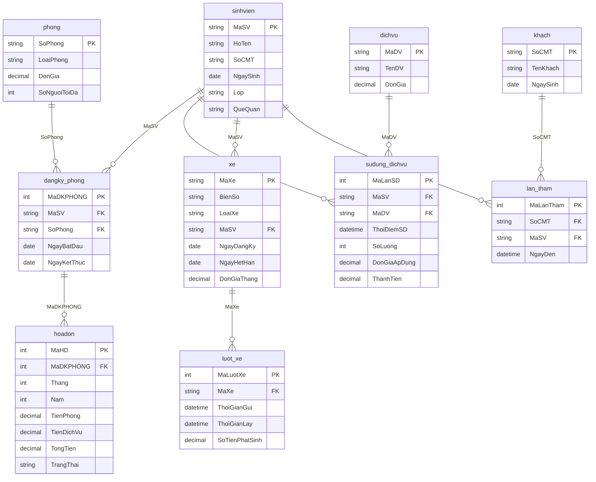

# 🏛️ HỆ THỐNG QUẢN LÝ KÝ TÚC XÁ SINH VIÊN (KTX)

Ứng dụng Desktop chuyên nghiệp quản lý toàn diện Ký túc xá sinh viên, được xây dựng chính xác theo sơ đồ cơ sở dữ liệu quan hệ gồm **10 bảng**:
1. `sinhvien`: Hồ sơ sinh viên nội trú.
2. `phong`: Danh mục phòng ký túc xá, loại phòng, đơn giá, sức chứa.
3. `dangky_phong`: Xếp phòng sinh viên, ngày bắt đầu, ngày kết thúc.
4. `hoadon`: Hoá đơn thanh toán tiền phòng & dịch vụ hàng tháng.
5. `dichvu`: Danh mục dịch vụ (giặt ủi, nước uống, wifi, gym...).
6. `sudung_dichvu`: Ghi nhận sinh viên sử dụng dịch vụ & tính thành tiền.
7. `xe`: Đăng ký xe vé tháng của sinh viên.
8. `luot_xe`: Lịch sử kiểm soát lượt xe ra / vào cổng KTX.
9. `khach`: Thông tin khách đến thăm sinh viên.
10. `lan_tham`: Ghi nhận thời điểm khách đến thăm sinh viên.

---

## 🏛️ Sơ Đồ Cơ Sở Dữ Liệu SQL (ERD)



---

## 🚀 Cách Chạy Ứng Dụng

Mở Terminal và chạy lệnh:
```bash
cd.....python3 main.py
```
*(Hoặc dùng lệnh `open /Users/tranhoang/.gemini/antigravity/scratch/student-management-app` để mở thư mục trong Finder)*
